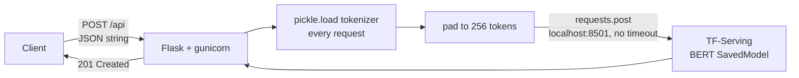
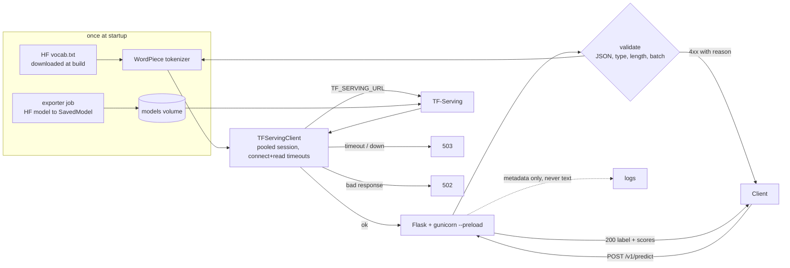

# bert-tfserving-api

[](https://github.com/s0yabean/bert-tfserving-api/actions/workflows/ci.yml)

A Flask API in front of TensorFlow Serving for a BERT text classifier: a model serving pattern from 2021, revisited in 2026.

I built the first version in 2021 while CTO of Mindreader, to put a fine-tuned BERT classifier behind an HTTP endpoint. This repo keeps that architecture (a thin Python API that tokenizes, and TF-Serving that runs the model) and fixes what a 2026 code review found wrong with it. The original model and training data are not public, so the repo exports a public BERT sentiment model from Hugging Face instead, and `docker compose up` gives a working stack.

## The problem

The serving split is sound. The Python process handles HTTP, validation and tokenization; TF-Serving handles batching, model versions and the heavy compute. The 2021 implementation of that split had several faults that only show up under load or in production:

| 2021 code | Why it mattered |
|---|---|
| `models/ai.py` called `pickle.load()` on a 1.4 MB tokenizer file **inside the request handler** | Every prediction paid the full tokenizer load before doing any work (measured below). Unpickling a file is also arbitrary code execution if that file is ever replaced. |
| TF-Serving URL hard-coded as `http://localhost:8501/...` (with a commented-out Docker bridge IP next to it) | Only worked when the API and TF-Serving shared a host. Moving to containers meant editing code. |
| `requests.post(...)` with no timeout and no status check | A slow or dead TF-Serving held a gunicorn worker forever. A TF-Serving error body became a `KeyError` and a bare 500. |
| Successful prediction returned **201 Created** | Nothing is created. Clients and proxies that treat 201 specially (caches, retries, monitoring) get the wrong signal. |
| Handler did `json.loads(request.get_json())` | Clients had to send a JSON *string* containing JSON. A normal JSON object failed with a 500. |
| Missing input returned 400 **with a fake prediction** `[0.0, 0.0, 0.0, 0.0]` | A client that ignored the status code would store a made-up result. |
| Long text silently cut at 1,500 characters | Callers never knew part of their input was ignored. |
| `Access-Control-Allow-Origin: *` on every response; CSRF middleware on a JSON API (then exempted) | Open CORS by default; dead configuration. |
| `start.sh` ran `pip install` on every container start, in an image that also installed TensorFlow 1.14 and pandas the API never used | Slow, network-dependent starts and a multi-GB image. |
| No health endpoint, no request logging | Orchestrators could not tell "up" from "ready", and there was no latency record. |

## Approach

Keep the split; move all one-time work to startup; make every boundary explicit.

**2021**



**2026**



| File | What it does |
|---|---|
| `bert_api/__init__.py` | `create_app()`: builds the tokenizer and TF-Serving client **once**, request ID and latency logging, JSON error handlers. Tokenizer and client are injectable for tests. |
| `bert_api/routes.py` | `POST /v1/predict` (one `text` or up to 32 `texts`), `GET /healthz` (liveness), `GET /readyz` (TF-Serving reports the model `AVAILABLE`) |
| `bert_api/serving.py` | `TFServingClient`: one `requests.Session`, `(connect, read)` timeouts, `ServingUnavailable` (→ 503) vs `ServingError` (→ 502) |
| `bert_api/tokenizer.py` | WordPiece tokenizer built from a public Hugging Face `vocab.txt`; truncates to `MAX_SEQ_LENGTH` with `[CLS]`/`[SEP]` |
| `bert_api/config.py` | All settings from environment variables (see `.env.example`) |
| `export/export_savedmodel.py` | Downloads a public BERT classifier and writes a TF-Serving SavedModel plus `labels.json` |
| `scripts/bench_tokenizer_load.py` | Measures per-request tokenizer load versus load-once |

### The fixes, before and after

**Tokenizer: per request → once at startup**

```python
# 2021: models/ai.py
def model_test(input_text):
    tokenizer = load_bert_tokenizer()          # pickle.load() of a 1.4 MB file, every call
    ...

# 2026: bert_api/__init__.py
def create_app(settings=None, tokenizer=None, client=None):
    ...
    app.extensions["tokenizer"] = tokenizer or load_tokenizer(...)   # once per process
```

gunicorn runs with `--preload`, so the tokenizer is built once in the master process and shared by the workers. The pickle no longer ships: the Dockerfile downloads the public `vocab.txt` at build time, and the container starts with `HF_HUB_OFFLINE=1`.

**Config: hard-coded host → environment**

```python
# 2021
ENV_VAR_URL_PREFIX = 'http://localhost:8501/v1/models/bert_model:predict'
response = requests.post(ENV_VAR_URL_PREFIX, data=json.dumps(data))

# 2026
TFServingClient(settings.tf_serving_url, settings.model_name,
                settings.connect_timeout_s, settings.read_timeout_s)
# compose sets TF_SERVING_URL=http://tfserving:8501
```

**Status codes and errors**

| Case | 2021 | 2026 |
|---|---|---|
| Successful prediction | 201 | 200 |
| Body is not JSON / wrong content type | 500 | 400 / 415 |
| Missing, empty or non-string text | 400 with fake scores, or 500 | 400 with an error code, no scores |
| Text over the limit | silently truncated | 413 (`MAX_TEXT_CHARS`); tokens beyond `MAX_SEQ_LENGTH` are truncated and `num_tokens` is returned |
| TF-Serving down or slow | worker hangs | 503 after the timeout |
| TF-Serving error body | 500 (`KeyError`) | 502 |

**Logging.** Each request logs one line: request ID, path, status, number of texts, total characters and latency. The input text is never logged; a test asserts this.

## Results

Measured locally on an Apple Silicon laptop, 200 sequential calls each, tokenization only (no model call).

**The original 2021 tokenizer** (the pickled `FullTokenizer`, 30,522-token vocab, measured once against the private repo; the file is not in this repo):

| | median | p95 |
|---|---|---|
| `pickle.load` + tokenize, every request (2021) | 12.3 ms | 23.9 ms |
| tokenize with a tokenizer loaded once | 0.11 ms | 0.54 ms |

About 12 ms of every request, roughly 100 times the tokenization itself, was spent reloading a file that never changed.

**This repo's tokenizer** (`python scripts/bench_tokenizer_load.py`, 105,879-token multilingual vocab):

| | median | p95 |
|---|---|---|
| build tokenizer + encode, every request | 139 ms | 235 ms |
| encode with a tokenizer built once | 0.04 ms | 0.06 ms |

The larger vocab makes the per-request mistake worse: it would have added about 140 ms to every call. Your numbers will differ by machine; the ratio is the point.

Tests: **29 pytest tests**, no network and no TF-Serving needed. They use a real WordPiece tokenizer over a tiny synthetic vocab and a fake TF-Serving client, and cover status codes, validation, batching and batch padding, truncation, timeouts and error mapping, readiness, CORS, request IDs, "the tokenizer is built once", and "the input text never appears in logs".

End to end (`docker compose up`, TF-Serving under amd64 emulation on Apple Silicon): `/readyz` returns 200 once the model loads; single and batched predictions return 200 with plausible labels (`"Excellent! Best service ever, I love it."` scores 0.98 for `5 stars`; `"Terrible. Worst experience, never again."` scores 0.93 for `1 star`); an empty body returns 400; with TF-Serving stopped, `/v1/predict` and `/readyz` both return 503 within the timeout instead of hanging.

## Quickstart

### Tests only (about 1 minute)

```bash
python3.11 -m venv .venv && . .venv/bin/activate
pip install -r requirements-dev.txt
pytest
```

### Full stack with Docker

```bash
docker compose up --build
```

The first run exports the model: the `exporter` service downloads [`nlptown/bert-base-multilingual-uncased-sentiment`](https://huggingface.co/nlptown/bert-base-multilingual-uncased-sentiment) (MIT licence, BERT-base, about 670 MB, labels `1 star` to `5 stars`) and writes a SavedModel to a Docker volume. Later runs skip the export. TF-Serving's official image is amd64 only, so on Apple Silicon it runs under emulation and is slower.

```bash
curl -s localhost:8000/readyz
curl -s localhost:8000/v1/predict -H 'Content-Type: application/json' \
  -d '{"text": "The team replied quickly and fixed it the same day."}'
curl -s localhost:8000/v1/predict -H 'Content-Type: application/json' \
  -d '{"texts": ["Great service.", "Nobody answered my emails for a week."]}'
```

Response to the batch call:

```json
{"model": "text_classifier",
 "results": [{"label": "5 stars", "num_tokens": 5,
              "scores": {"1 star": 0.0043, "2 stars": 0.0042, "3 stars": 0.0263, "4 stars": 0.2518, "5 stars": 0.7134}},
             {"label": "1 star", "num_tokens": 12,
              "scores": {"1 star": 0.7742, "2 stars": 0.1776, "3 stars": 0.0392, "4 stars": 0.0052, "5 stars": 0.0038}}]}
```

### Using a different model

Any Hugging Face BERT sequence classifier with TensorFlow weights (or that `transformers` 4.x can convert) works. Set the same id for the exporter and the tokenizer:

```bash
HF_MODEL_ID=<org>/<bert-classifier> docker compose up --build
```

To run the exporter without compose: `pip install -r export/requirements.txt && python export/export_savedmodel.py --out ./models`.

### Tokenizer benchmark

```bash
python scripts/bench_tokenizer_load.py --n 200
```

## Repo layout

```
bert_api/            Flask app: config, tokenizer, TF-Serving client, routes
export/              one-shot job: Hugging Face model -> TF-Serving SavedModel
scripts/             tokenizer load benchmark
tests/               pytest, fake TF-Serving client, synthetic vocab
Dockerfile           API image (deps and vocab at build time, non-root, healthcheck)
docker-compose.yml   exporter -> tfserving -> api
.env.example         every setting, with defaults
```

## Design decisions and what I'd do next

- **Kept TF-Serving.** In 2026 the same job is often done by Triton, TorchServe or a managed endpoint, but the pattern (thin API for HTTP and tokenization, separate model server) is unchanged, and TF-Serving still loads new model versions from a directory without a restart.
- **Tokenizer from the model's own repo.** The API downloads `vocab.txt` from the same Hugging Face repo the model was exported from, so the tokenizer and the model cannot drift apart silently. A pickled tokenizer file has no such link.
- **Dynamic sequence length.** The 2021 code padded every input to 256 tokens. The SavedModel signature here takes `[batch, seq_len]`, so short texts send short tensors; a batch is padded only to its longest text, with attention mask 0 on the padding.
- **No retries.** A prediction is cheap to retry from the client, and retrying inside the API doubles load on a model server that is already struggling. The API fails fast with 503 instead.
- **Next:** gRPC to TF-Serving for lower overhead, request batching across concurrent callers, authentication (the 2021 handler had a comment where it should have been), and Prometheus metrics instead of log lines.

## Licence

MIT, copyright Tony Tong. The default model is [`nlptown/bert-base-multilingual-uncased-sentiment`](https://huggingface.co/nlptown/bert-base-multilingual-uncased-sentiment) (MIT, NLP Town); it is downloaded at run time and not included in this repo.
